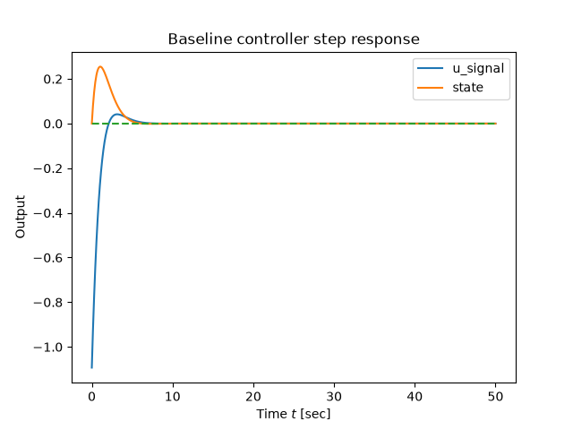
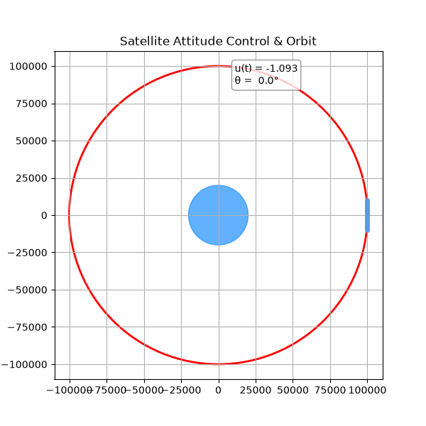
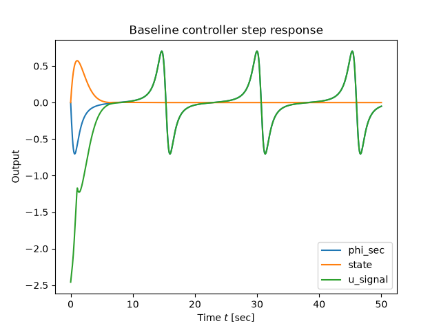
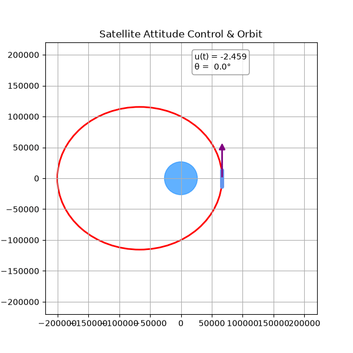

# Satellite Orientation Correction Project

In this project, we formulate the orientation of a satellite as a control problem and solve it using **Linear Quadratic Regulator** (**LQR**).
We first approximate the orbit by a circle and then propose a global solution for the ellipse case obtained from applying Newton's second law.

The goal of this project was not merely to propose an application of **LQR** but also to provide explanations of how we got there. For this purpose in the **documentation** folder, you can find a mathematical modelisation of our system using Newton's second law and a presentation of our LQR system.

> [!NOTE]
> The documentation will be added in the future

## Cyclic case
We first tackle the cyclic case where we made the simplification of taking the angular acceleration of our sattelite around the earth as a null quantity (see **documentation** for detail).

We can see below the control applied (u_signal) and the gap between actual orientation and the one facing the earth at all time (state).

 \

Here is the visualisation of the correction of the orientation of our satellite.

 \

## Elliptic case
After that we solved the general case removing our hypothesis on the angular acceleration being null, the detail of our solution can be found in the documentation.

We place below the graphic of our state and u_signal according to time, we see our state reaching our target of 0 and our control being periodic, this is due to the angular acceleration being non null and needing varying compensation in regard to time.

 \

Here is the visualisation of the correction of the orientation of our satellite for the elliptic case.

 \

> We used a configuration (perigee around 67 km, semi latus rectum around 99km) adapted to visualization, but not really realistic. Normally even though 
> the u-signal is periodic, it is closer to 0 given the angular acceleration is also closer to 0 due to the orbit period being longer, making the 
> amplitude too small to notice the periodicity of the control.