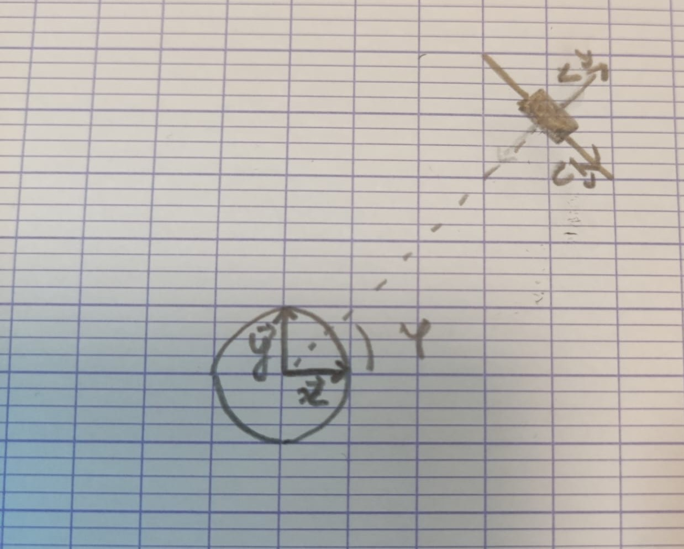

# Physical modelisation of the context

For our probleme, we suppose a planet of mass $M$ and a satellite of mass $m$ that is orbiting around it.
Our first objective is to get the system of differential equation that define our closed system, for this we're gonna use the famous Newton's second law $\vec{F} = m\vec{a}$ that says the sum of forces equal mass time acceleration.
For our system, there is only one force that is applied on our satellite which is gravity in the direction going from the satellite to the center of gravity of the planet in a straight line.

 

Using the image above, we first can observe that the position of our satellite at every moment is 
$$
\begin{equation} 
\vec{p} = r \cdot \vec{v}
\end{equation}
$$

then 

$$\begin{equation} 
\vec{vel} = \frac{d\vec{p}}{dt} = \frac{dr}{dt} \cdot \vec{v} + r \cdot \frac{d\vec{v}}{dt} 
\end{equation}
$$

and 

$$ 
\begin{equation} \vec{a} = \frac{d\vec{vel}}{dt} = \frac{d^{2}r}{dt^{2}} \cdot \vec{v} + 2 \frac{dr}{dt} \cdot \frac{d\vec{v}}{dt} + r \cdot \frac{d^{2}\vec{v}}{dt^{2}} 
\end{equation} 
$$

but we also know that 

$$ 
\begin{equation}
    \begin{cases}
        \vec{u} = sin(\varphi) \vec{x} - cos(\varphi) \vec{y}\\
        \vec{v} = cos(\varphi) \vec{x} + sin(\varphi) \vec{y}\\
    \end{cases}
\end{equation}
$$
Then, considering $ \vec{x} $ and $ \vec{y} $ are constant in function of time, we have :
$$ 
\begin{equation*}
    \begin{cases}
        \frac{d\vec{u}}{dt} = \frac{d\varphi}{dt} \cdot (cos(\varphi) \vec{x} + sin(\varphi) \vec{y}) \\
        \frac{d\vec{v}}{dt} = \frac{d\varphi}{dt} \cdot (- sin(\varphi) \vec{x} + cos(\varphi) \vec{y})\\
    \end{cases}
\end{equation*}
$$

$$ 
\begin{equation}
    \begin{cases}
        \frac{d\vec{u}}{dt} = \frac{d\varphi}{dt} \cdot \vec{v} \\
        \frac{d\vec{v}}{dt} = \frac{d\varphi}{dt} \cdot (- \vec{u})\\
    \end{cases}
\end{equation}
$$

and by re deriving in function of t we obtain :

$$ 
\begin{equation}
    \begin{cases}
        \frac{d^{2}\vec{u}}{dt^{2}} = \frac{d^{2}\varphi}{dt^{2}} \cdot \vec{v} + (\frac{d\varphi}{dt})^{2} \cdot (- \vec{u}) \\
        \frac{d^{2}\vec{v}}{dt^{2}} = \frac{d^{2}\varphi}{dt^{2}} \cdot (- \vec{u}) - (\frac{d\varphi}{dt})^{2} \cdot \vec{v} \\
    \end{cases}
\end{equation}
$$

Thus our equation $(3)$ becomes :

$$ \begin{equation} 
\vec{a} = \frac{d^{2}r}{dt^{2}} \cdot \vec{v} - 2 \frac{dr}{dt} \cdot \frac{d\varphi}{dt} \cdot \vec{u} - r (\frac{d^{2}\varphi}{dt^{2}} \cdot \vec{u} + (\frac{d\varphi}{dt})^{2} \cdot \vec{v}) 
\end{equation} $$

Then using Newton's second law, we get :

$$ 
\begin{equation}
    \begin{cases}
        - \frac{M \cdot m}{r^{2}}G =  m (\frac{d^{2}r}{dt^{2}} - r (\frac{d\varphi}{dt})^{2} ) \\
        0 =  2 \frac{dr}{dt} \cdot \frac{d\varphi}{dt} \cdot \vec{u} + r \cdot \frac{d^{2}\varphi}{dt^{2}} \cdot \vec{u} \\
    \end{cases}
\end{equation}
$$
Which we can simplify by dividing by $m$ on both sides of the first equation
$$ 
\begin{equation*}
    \begin{cases}
        - \frac{M}{r^{2}}G =  \frac{d^{2}r}{dt^{2}} - r(\frac{d\varphi}{dt})^{2} \\
        0 =  2 \frac{dr}{dt} \cdot \frac{d\varphi}{dt}  + r \cdot \frac{d^{2}\varphi}{dt^{2}} \\
    \end{cases}
\end{equation*}
$$

